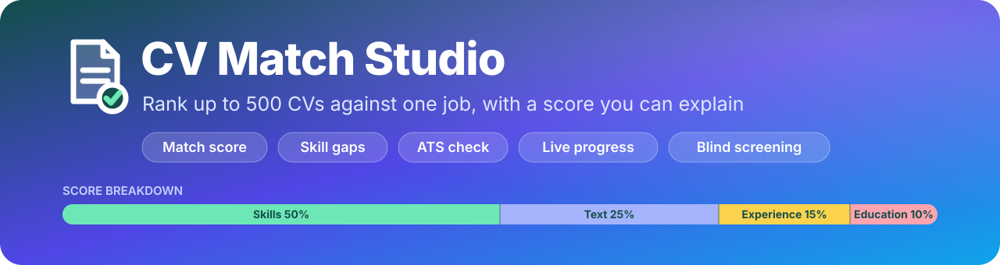

<div align="center">



### *Rank hundreds of CVs against one job, and see exactly why each one scored what it did*

[](https://www.python.org/)
[](https://streamlit.io/)
[](https://scikit-learn.org/)
[](https://www.nltk.org/)
[](LICENSE)
[](https://github.com/zarshanali/CV-Match-Studio/actions)

**Resume Screening | Skill-Gap Analysis | ATS Check | Batch Processing**

[Overview](#-overview) • [Features](#-key-features) • [Score](#-how-the-match-score-works) • [Settings](#-settings-reference) • [Quick start](#-quick-start) • [Input](#-supported-input) • [Structure](#-project-structure) • [Troubleshooting](#-troubleshooting)

[](https://colab.research.google.com/github/zarshanali/CV-Match-Studio/blob/main/notebooks/Resume_Analyzer_Colab.ipynb)

</div>

---

## 🌟 Overview

**CV Match Studio** is a resume screening and job-matching tool. You paste a job description, drop in a pile of CVs, and it tells you which ones fit, how well, and why. For every CV it shows the **skills the job asks for that the CV is missing**, an **ATS readability score**, and plain-language advice on what to fix first.

It handles up to **500 CVs in a single run** (PDF, DOCX, DOC, RTF, ODT, TXT, HTML, scanned images, or a **ZIP** full of CVs, up to **50 MB each**), and every CV gets its **own** score breakdown, report and downloads. Job seekers can use it with a single CV; recruiters can use it to build a shortlist. The interface is a Streamlit app that runs locally or in Google Colab, and **everything is uploaded in the browser**. There is nothing to edit in code.

---

### 🎯 Why this project?

Reading hundreds of CVs for one opening is slow, inconsistent, and easy to get wrong. Most tools return a single unexplained percentage. This one shows where the number comes from, so a human can trust it, question it, and act on it.

| | |
|---|---|
| 🔍 **Explainable** | The match % is four visible parts (skills, wording, experience, education) with their weights. Nothing is a black box, and the weights are adjustable. |
| 📂 **Reads anything** | PDF, DOCX (including text boxes and tables), old DOC, RTF, ODT, HTML, TXT, photos and scans of CVs (OCR), and ZIP files. The format is detected from the file's **content**, so a wrongly named file still works. |
| ⚡ **Fast by design** | Files are read in parallel. The job description is read **once** and reused for every CV. In a local test, **213 mixed files finished in about 5 seconds**. |
| 🛡️ **Fault tolerant** | One unreadable, empty or password-protected file is marked failed with the reason; the others carry on. Exact duplicate CVs are detected and skipped. |
| 🔄 **Reload-safe** | The analysis runs in a background thread shared by every browser tab. Reloading the page does not lose the run. |
| ⚖️ **Fairness-minded** | Names, photos, age, gender and addresses are never scored. **Blind screening** shows *Candidate 001…* instead of file names. Results are a shortlist for a human, never an automatic rejection. |
| 💻 **Runs on a laptop** | Classical ML only: no GPU, no paid API, no data sent anywhere. |
| ✅ **Tested** | A pytest suite (file readers, matching, the full batch job) runs offline in CI on every push. |

---

## 🚀 Key Features

<table>
<tr>
<td width="50%">

### 🧠 Matching Intelligence
- **Skills read from the job itself**: required vs preferred, with aliases (`ML`, `sklearn`, `CI/CD`, `k8s`…)
- **Match %** from skills, wording, experience and education
- **Missing skills** for every CV, plus **words the job uses that the CV never does**
- **Years of experience and degree level** extracted automatically
- **Best-fit role** from a trained ML model (optional)
- **Meaning-based similarity** with sentence embeddings (optional)

</td>
<td width="50%">

### 🎨 Interface
- **Live progress** with a status tile per file, a progress table and a timing breakdown
- **Results tab** with a ranked table and a full report for each CV
- **Filters**: minimum match, Shortlist / Review / Low, **must-have skills**, name search
- **Sidebar settings** for weights, thresholds, OCR and blind screening
- **One-click downloads**: ranking CSV, per-CV Markdown report, or a ZIP of everything
- **Saved runs** that can be reopened later

</td>
</tr>
<tr>
<td width="50%">

### 📥 Flexible Input
- Up to **500 files** per run, **50 MB** each (limit is configurable)
- Drop files one by one, many at once, or **one ZIP**
- Scanned PDFs and photos are read with **OCR**
- UTF-8, UTF-16 and Latin-1 text is detected automatically

</td>
<td width="50%">

### 🔧 Engineering
- Background job thread with live, thread-safe state
- Parallel file reading, one-time job-description parsing
- Graceful fallbacks: NLTK data missing, no OCR, no `antiword`, no embedding model
- Modular package with a test suite and CI

</td>
</tr>
</table>

---

## 📊 What You Get

For **every** CV:

| Output | What it shows |
|---|---|
| **Match %** | A score with a verdict (*Excellent / Good / Partial / Weak match*) and a strip showing how much each of the four parts contributed. |
| **Skills the job asks for** | Which required and preferred skills the CV has, which are missing, other skills on the CV, and job words the CV never uses. |
| **What to do next** | Prioritised, honest advice. It tells people not to add skills they cannot back up in an interview. |
| **ATS readability /100** | Twelve checks (contact details, sections, length, measurable results, action verbs, structure, tone), each with a tip when it fails. |
| **Profile** | Years of experience, education level, number of skills found, word count. |
| **Best-fit roles** | Top three job categories with confidence, and the skills to build for each (needs the trained model). |
| **Downloads** | A Markdown report per CV. |

Across the whole run:

| Output | What it shows |
|---|---|
| **Live Progress** | A progress bar, four KPI cards (files finished, elapsed time, speed, problems), a status tile per file, a live table, and a *Where the time went* breakdown. |
| **Ranked table** | One row per CV: rank, match %, suggestion, skills matched, missing required skills, years, education, ATS score, best-fit role. |
| **Saved runs** | Every run is written to `outputs/<timestamp>/` (`ranking.csv`, `reports.zip`, `results.json`). **Load last saved run** reopens it. |

---

## 🧠 How It Works

```mermaid
flowchart LR
    A["📄 Upload<br/>CVs or a ZIP"] --> B["📖 Read<br/>any format, in parallel"]
    B --> C["🧹 De-duplicate<br/>skip identical CVs"]
    C --> D["🔎 Extract<br/>skills, years, degree"]
    D --> E["⚖️ Match<br/>4-part score vs the job"]
    E --> F["✅ ATS check<br/>+ advice"]
    F --> G["🏷️ Best-fit role<br/>ML model"]
    G --> H["📊 Rank & export<br/>table, reports, CSV, ZIP"]

    style A fill:#e0e7ff,stroke:#4f46e5
    style E fill:#fef3c7,stroke:#d97706
    style G fill:#f3e8ff,stroke:#7c3aed
    style H fill:#d1fae5,stroke:#059669
```



1. **Read.** Each file's type is detected from its first bytes, then converted to text: PDF (`pypdf`, then `pdftotext`, then OCR for scans), DOCX (straight from the XML, so text boxes, tables and headers are included), old DOC (`antiword`, `catdoc` or LibreOffice, with a rough fallback), RTF, ODT, HTML, TXT and images (OCR). Several files are read at once.
2. **De-duplicate.** CVs with identical text are skipped, and the note says which file they duplicate.
3. **Extract.** Skills are matched against a vocabulary of about 270 skills with aliases, using word boundaries so `java` does not match `javascript` and a stray `R` does not count as the R language. Years of experience come from statements like "5 years of experience" or from merged date ranges **inside the Experience section** (study years are not counted as work). Degree level is the highest one found.
4. **Match.** The job description is read once (required vs preferred skills, years asked, degree asked), then compared with every CV. See [below](#-how-the-match-score-works).
5. **Check and advise.** The ATS checks run and the advice is written from the gaps found.
6. **Predict the role.** A Logistic Regression / Naive Bayes model on TF-IDF features (trained on the Kaggle *Updated Resume Dataset*) suggests the best-fit job categories, and the app also shows what kind of role the job description reads like.
7. **Rank and export.** CVs are ranked and everything can be filtered and downloaded.

### 🧱 Core Technical Stack

| Role | Default | What it does |
|:---|:---|:---|
| **Skill extraction** | Vocabulary + aliases + regex | Finds skills in the job and in each CV, separating required from preferred. |
| **Text similarity** | TF-IDF cosine (`scikit-learn`) | Measures wording overlap between a CV and the job. |
| **Meaning similarity** *(optional)* | `all-MiniLM-L6-v2` | Understands that "built ML models" ≈ "machine learning engineer". All CVs are embedded in one batch. |
| **Role model** *(optional)* | Logistic Regression / Naive Bayes | Predicts the best-fit job category from the CV text. |
| **File readers** | `pypdf`, XML readers, `antiword`, `tesseract` | Turn any supported file into text. |
| **Interface** | Streamlit | Fragment-based live dashboard with a background job thread. |

---

## ⚖️ How the Match Score Works

| Part | Weight | What is compared |
|:---|:---:|:---|
| **Skills** | 50% | Skills in the job vs skills in the CV. Required = 1.0, preferred = 0.5, soft skills count half. |
| **Text similarity** | 25% | TF-IDF cosine similarity of the cleaned texts (blended with embedding similarity if enabled). |
| **Experience** | 15% | Years found in the CV ÷ years the job asks for (capped at 100%). |
| **Education** | 10% | 100% if the CV's degree level meets the job's; otherwise a partial score. For "Bachelor's or Master's" the lower level is the requirement. |

**A part the job does not mention is skipped and the other weights are re-scaled**, so a job is never penalised for something it did not ask for.

| Match % | Verdict | | Match % | Default suggestion |
|:---:|:---|:-:|:---:|:---|
| 75 + | Excellent match | | 65 + | **Shortlist** |
| 55 – 74 | Good match | | 40 – 64 | **Review** |
| 35 – 54 | Partial match | | below 40 | **Low match** |
| below 35 | Weak match | | | |

The suggestion thresholds are adjustable in the sidebar.

> 💡 **Tip:** write or paste the job description with headings such as **Requirements** and **Nice to have** / **Preferred**. The app uses them to separate required skills (full weight) from preferred skills (half weight).

---

## 🔧 Settings Reference

All settings live in the sidebar.

### 1. Match score weights &nbsp;`4 sliders: 0 to 100`

Set how much **Skills**, **Text similarity**, **Experience** and **Education** count (defaults 50 / 25 / 15 / 10). The values are re-scaled to add up to 100%. Raise *Skills* to favour exact skill coverage; raise *Experience* for senior roles.

### 2. Meaning-based similarity &nbsp;`Toggle` · default `Off`

| State | Behaviour |
|:---|:---|
| **Off** | Text similarity uses word overlap (TF-IDF) only. Fast. |
| **On** | Adds sentence-embedding similarity (MiniLM) so related wording counts. Needs `sentence-transformers`; the first use downloads about 90 MB. |

Disabled automatically if `sentence-transformers` is not installed.

### 3. Suggest best-fit role &nbsp;`Toggle` · default `On` if a model exists

Uses the trained model in `models/` to show the best-fit job categories. Disabled if the model files are missing (run `python train.py`).

### 4. Read scanned CVs (OCR) &nbsp;`Toggle` · default `On` if tesseract is installed

Only used for image files and PDFs that contain no text. It takes a few seconds per page (the first 3 pages of a scanned PDF are read). Disabled if `tesseract` is not installed.

### 5. Shortlist / Review thresholds &nbsp;`Sliders` · defaults `65` and `40`

Set the match % from which a CV is labelled **Shortlist** and **Review**. They change the labels and counts instantly, without re-running the analysis.

### 6. Blind screening &nbsp;`Toggle` · default `Off`

Shows **Candidate 001, 002…** instead of file names (file names often contain the person's name). Also applies to the CSV and ZIP downloads.

### 7. Results filters

| Filter | What it does |
|:---|:---|
| **Minimum match %** | Hide everything below a score. |
| **Show** | Keep only Shortlist, Review and/or Low match. |
| **Must-have skills** | Keep only CVs that have **all** of the chosen required skills. |
| **Search by name** | Find a file by part of its name (disabled in blind mode). |

Also in the sidebar: **Load last saved run**.

---

## ⚡ Quick Start

### Option A · Run locally

```bash
# 1. Clone the repository
git clone https://github.com/zarshanali/CV-Match-Studio.git
cd CV-Match-Studio

# 2. Create an environment
python -m venv .venv
source .venv/bin/activate            # Windows: .venv\Scripts\activate

# 3. Install the dependencies
pip install -r requirements.txt

# 4. Start the app
streamlit run app.py
```

Open the address Streamlit prints (usually http://localhost:8501).

**Optional but recommended: better file support**

| Install | Gives you |
|:---|:---|
| `antiword` (or LibreOffice) | Exact text from old **.doc** files. Without it a rougher fallback is used. |
| `tesseract-ocr` | Reading **scanned PDFs and photos** of CVs. |
| `poppler-utils` | `pdftotext` and `pdftoppm` (a second PDF reader, and needed for scanned PDFs). |
| `sentence-transformers` *(pip)* | Meaning-based similarity. |

```bash
# Debian / Ubuntu / Colab
sudo apt-get install -y antiword tesseract-ocr poppler-utils
# macOS
brew install antiword tesseract poppler
# Windows: install Tesseract (UB-Mannheim build) and poppler, then add them to PATH
```

**Optional: train or refresh the role model**

Download `UpdatedResumeDataSet.csv` from [Kaggle](https://www.kaggle.com/datasets/jillanisofttech/updated-resume-dataset) into `dataset/`, then:

```bash
python train.py
```

It removes duplicate resumes, compares models with cross-validation, and writes `models/metrics.json`. A trained model is included, and the match %, skills, ATS check and ranking work without it.

### Option B · Run in Google Colab

1. Open `notebooks/Resume_Analyzer_Colab.ipynb` in Colab (or use the **Open in Colab** badge above).
2. **Run all.** It installs everything, writes the project files, and (optionally) trains the role model.
3. Open the printed `trycloudflare.com` link and keep the launch cell running.
4. Upload your CVs **in the web page**, not in code.

> ⚠️ The Colab link is public and has security checks turned off so the tunnel can work. Don't share it, and don't upload CVs you are not allowed to share.

### Using the app

1. **Paste the job description** (or click *Use an example job*). Leave it empty to only profile the CVs.
2. **Drop your CVs**: many files at once, or one ZIP, then press **🚀 Analyze**.
3. Watch the **📊 Live progress** tab. You can switch tabs or reload the page; the run continues.
4. Open the **📄 Results** tab, filter the table, open any CV for its full report, and download what you need.

---

## 📥 Supported Input

| Format | How it is read | Notes |
|:---|:---|:---|
| **PDF** | `pypdf`, then `pdftotext`, then OCR | First 25 pages. Scans need `tesseract`. Password-protected PDFs are reported as such. |
| **DOCX** | Straight from the XML | Includes tables, headers, footers and text boxes. |
| **DOC** (old Word) | `antiword` → `catdoc` → LibreOffice → rough fallback | The app says when the text was read approximately. |
| **RTF, ODT** | Built-in readers | |
| **HTML** | Tag stripper | Scripts and styles are ignored. |
| **TXT, MD, LOG, CSV** | Encoding auto-detected | UTF-8, UTF-16 or Latin-1. |
| **PNG, JPG, TIFF, BMP** | OCR | Needs `tesseract`. |
| **ZIP** | Unpacked in memory | One level; folders, hidden and system files are skipped. Every CV inside counts toward the limit. |

Files are recognised by their **content**, so a DOCX named `.doc` or a PDF named `.txt` still works. Excel and PowerPoint files are rejected with a clear message.

---

## 🔒 Responsible Use

CV screening affects people's livelihoods, so the tool is built to **support a human decision, not replace it**.

- **What is scored:** skills, experience, education and wording. **Not** names, photos, age, gender or addresses.
- **Blind screening** hides file names, which often contain the person's name.
- **Suggestions, not verdicts:** the labels are *Shortlist*, *Review* and *Low match*. There is no automatic rejection.
- **A low score means the CV does not *show* the skills in the posting.** It does not mean the person is unsuitable. Review borderline CVs by hand.
- **Bias can still exist.** The skill vocabulary and the role model reflect the data they were built from. Test with diverse CVs before relying on it, and check the rules that apply where you hire.
- **Privacy:** CVs are processed in memory on your machine (or your own Colab runtime) and never sent to an external API. Only the reports you generate are saved, in `outputs/`.

---

## 📁 Project Structure

```
CV-Match-Studio/
├── 📜 app.py                      # Streamlit entry point
├── 📂 resume_ai/
│   ├── config.py                  # limits, weights, thresholds, accepted file types
│   ├── readers.py                 # any file format → text (PDF, DOC, DOCX, RTF, ODT, HTML, images, ZIP)
│   ├── skills.py                  # skill vocabulary and aliases
│   ├── extractor.py               # contacts, sections, years of experience, education
│   ├── matcher.py                 # 4-part match score (job read once, reused for every CV)
│   ├── ats.py                     # ATS readability checks
│   ├── advice.py                  # plain-language next steps
│   ├── predictor.py               # best-fit role model
│   ├── semantic.py                # optional embedding similarity (batched)
│   ├── analyzer.py                # everything about one CV
│   ├── preprocessing.py           # text cleaning (NLTK, with fallbacks)
│   ├── job.py                     # background job: read → analyse → rank → save
│   ├── exporters.py               # table rows, CSV, Markdown reports, ZIP, saved runs
│   └── ui.py                      # the Streamlit page
├── 📂 tests/                      # pytest suite: readers, matching, full batch job
├── 📂 notebooks/
│   └── Resume_Analyzer_Colab.ipynb   # one-click Google Colab version
├── 📂 samples/                    # example CVs and job descriptions to try
├── 📂 models/                     # tfidf.pkl, model.pkl (+ metrics.json after train.py)
├── 📂 docs/
│   └── banner.svg                 # README banner
├── 📂 .streamlit/
│   └── config.toml                # server settings
├── 📂 .github/workflows/
│   └── tests.yml                  # tests on every push
├── 📜 train.py                    # train and evaluate the role model
├── 📜 make_presentation.py        # generates the PowerPoint slides
├── 📜 requirements.txt
├── 📜 requirements-dev.txt
├── 📜 LICENSE
└── 📜 README.md
```

---

## 🧪 Testing

```bash
pip install -r requirements-dev.txt
python -m pytest -q
```

The tests run **offline** and need no GPU, no OCR and no model download. They cover every file reader (including wrong extensions, damaged files and ZIPs), skill extraction, experience and education parsing, the match score and its re-weighting, the ATS check, and a full end-to-end batch run with a deliberately empty file, a junk file and a duplicate that must not stop the others. GitHub Actions runs the same suite on Python 3.10 and 3.12 on every push. The Streamlit page itself is not covered by automated tests yet.

---

## 🔍 Troubleshooting

<details>
<summary><b>A .doc file says "read approximately"</b></summary>

The old Word format needs a converter for exact text. Install `antiword` (or LibreOffice), or ask for the CV as DOCX or PDF.
</details>

<details>
<summary><b>A PDF says "No text found"</b></summary>

It is a scanned image. Install `tesseract-ocr` and `poppler-utils` and keep *Read scanned CVs (OCR)* switched on in the sidebar.
</details>

<details>
<summary><b>A file is marked "Failed"</b></summary>

The *Note* column in the live table gives the reason (empty file, unsupported type, damaged file, password-protected PDF…). Other files in the run are not affected.
</details>

<details>
<summary><b>Skills I expect are not found</b></summary>

Skills come from a hand-curated vocabulary. Add yours to `EXTRA_SKILLS` and `ALIASES` in `resume_ai/skills.py` and restart the app.
</details>

<details>
<summary><b>"N files found, the limit is 500"</b></summary>

Split the files into batches, or raise the limit: `CV_MAX_DOCS=1000 streamlit run app.py` (Windows PowerShell: `$env:CV_MAX_DOCS=1000; streamlit run app.py`). Each run is saved separately and can be reopened with **Load last saved run**.
</details>

<details>
<summary><b>The Role suggestions are switched off</b></summary>

The model files are missing from `models/`. Run `python train.py` after placing the dataset in `dataset/`.
</details>

<details>
<summary><b>The page doesn't load in Colab</b></summary>

Run `!tail -n 40 streamlit.log` in a new cell to see the app log, then re-run the launch cell.
</details>

<details>
<summary><b>Code changes don't show up</b></summary>

The Streamlit file watcher is turned off in `.streamlit/config.toml`. Restart the app after editing code.
</details>

---

## 🚧 Limitations

- Tuned for **English** CVs (stop-word lists, skill vocabulary and the optional embedding model are English).
- Skills are matched from a **hand-curated vocabulary**; skills that are not in it are not seen.
- Years of experience and degree level use **pattern matching** and can be wrong on unusual layouts, or on CVs that list dates without an Experience heading.
- **OCR is slow** (a few seconds per page) and can misread poor scans.
- The role model knows only the **25 categories** of the Kaggle dataset, and that dataset contains many duplicate resumes, so its published accuracy overstates real-world performance. `train.py` removes duplicates before evaluating; expect lower numbers on real CVs.
- A **500 CV** limit per run by default, and uploaded files are held in memory until they are read.

## 🧭 Roadmap Ideas

- [ ] 🧩 Learn the skill vocabulary automatically from many job postings
- [ ] 🌍 Multilingual CVs and embedding model
- [ ] 🗄️ Database storage with saved jobs and candidates
- [ ] ✍️ LLM-assisted rewrite suggestions and interview questions
- [ ] 📄 PDF / HTML report export
- [ ] 🐳 Docker image and one-click deployment

---

## 🤝 Contributing

Contributions are welcome.

1. Fork the repository
2. Create a branch (`git checkout -b feature/my-feature`)
3. Install the dev dependencies and run `python -m pytest -q`
4. Commit and push (`git commit -m "Add my feature"`, `git push origin feature/my-feature`)
5. Open a pull request

## 📄 License

This project is licensed under the **MIT License**. See the [LICENSE](LICENSE) file for details.

> The code is MIT-licensed. The following are **not** part of this repository and keep their own licenses:
> - **Python libraries** (Streamlit, scikit-learn, NLTK, pypdf, …) are installed from PyPI under their own permissive licenses.
> - **System tools** (`antiword`, `tesseract`, `poppler`, LibreOffice) are installed separately and called as external programs; none is bundled.
> - **Models**: the optional MiniLM embedding model is downloaded from Hugging Face on first use (see its model card).
> - **Dataset**: the Kaggle *Updated Resume Dataset* is **not** included. Check its terms on Kaggle before redistributing it or models trained on it.

---
"# ShortlistAI" 
